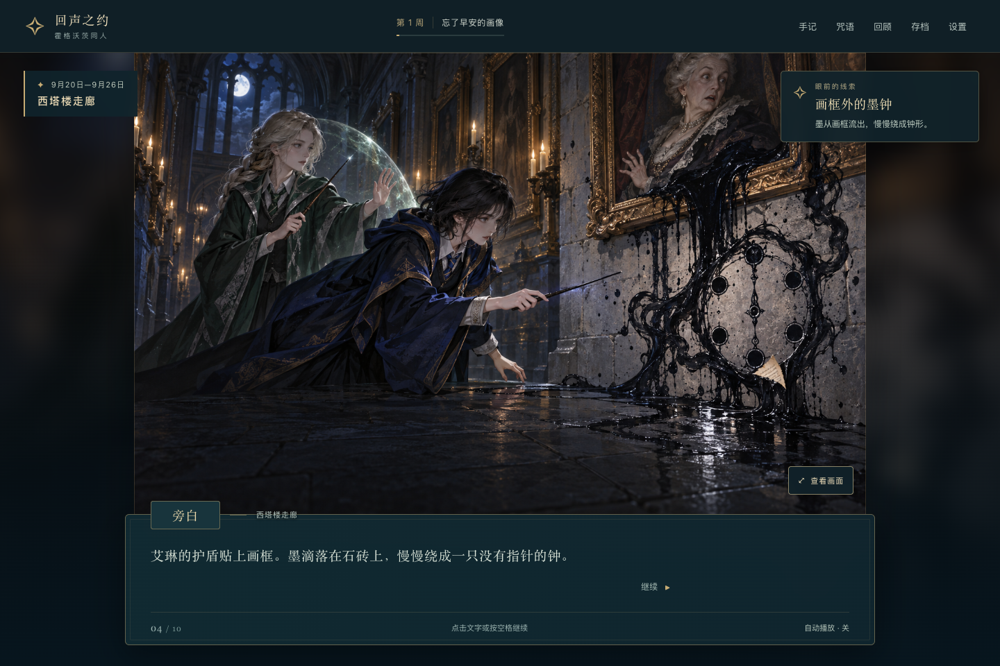
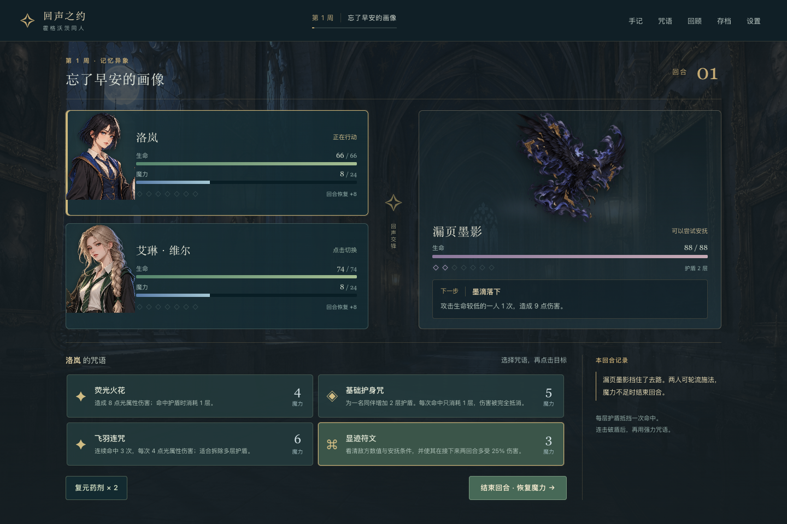
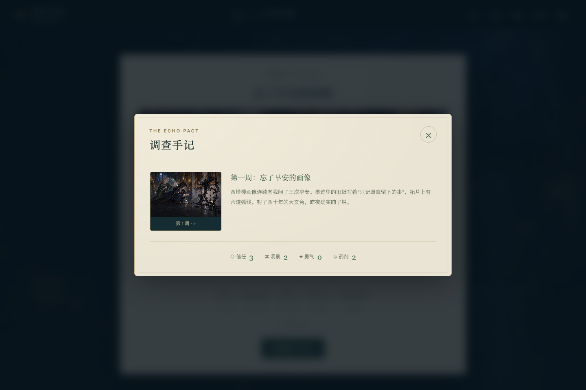
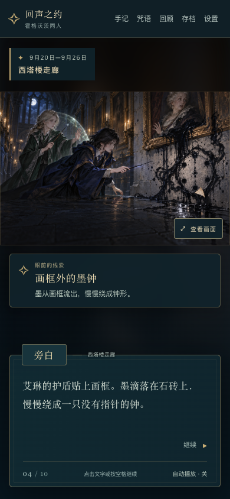
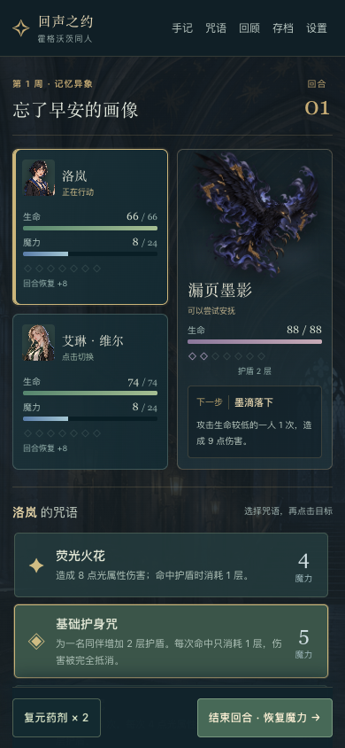

# 霍格沃茨：回声之约

**一部可在浏览器游玩的中文魔法校园短篇：安排课程、并肩施法，在万圣夜前找回六段失落的记忆。**

霍格沃茨的画像开始遗忘，废弃天文台却在午夜响起钟声。你将扮演七年级学生洛岚，与艾琳·维尔一起调查漏墨的画框、空白的名册和一封旧信。六周之后，你们要决定：这些记忆该被修复、收藏，还是放下？

本作包含原创人物与中文剧情，以视觉小说、课程成长和双人回合制战斗串起一段完整故事。支持桌面与手机浏览器；当前版本为 **1.2.0**。

[GitHub 仓库](https://github.com/TaulGit/hogwarts-echo-pact-cn) · [验证记录](验证记录.md) · [美术说明](ART.md)



## 内容与玩法

| 内容 | 规模与特点 |
| --- | --- |
| 剧情 | 6 周调查、12 处决策，每处 3 个选项；信任、洞察与勇气影响 4 种结局 |
| 课程 | 5 门课程，每周选 2 门不同课程；每门最高 3 级，逐步解锁法术 |
| 战斗 | 7 场交锋、19 条技能；双人行动，按各自魔力在同一回合连续施法 |
| 插画 | 共 22 张生成素材，含 11 张剧情与结局插画；关键画面可放大查看 |
| 呈现 | 墨滴、齿轮、银叶、涟漪与钟环等轻量动效，战斗飞光及实际数值浮字 |
| 存档 | 本机自动保存、JSON 导入/导出，以及星匣内手动云档同步 |

战斗中，每层护盾抵挡一次命中：先用连击拆盾，再寻找强击的时机。敌方下一步行动会提前显示，也可以尝试在其生命与护盾较低时安抚异象。战败后能重试或接受援助继续故事。

### 1.2 新增内容

- 新增 **11 张剧情与结局插画**，对应六周线索、守钟咒现身和四种结局。
- 画面随调查进展切换，附简短事件说明；调查手记、每周总结和已解锁结局收藏均配图。
- 新增场景与战斗动效，伤害、护盾和回蓝浮字来自实际数值变化。
- 动效首次跟随系统偏好，也能在设置里手动开关；关闭后保留画面、线索与数值反馈。
- 兼容已有存档。旧存档正在阅读的段落会保留已保存的文字，进入下一段后使用新版内容。

## 画面

### 双人魔法战斗



### 带图手记与手机阅读



 

## 本地游玩

运行游戏只需 **Python 3 和现代浏览器**，无需安装 npm 依赖或构建。

1. 下载或克隆仓库，进入项目目录。
2. 运行：

   ```bash
   python3 play.py
   ```

3. 浏览器会自动打开游戏。关闭终端窗口或按 `Ctrl+C` 停止服务。

macOS 也可双击 `启动游戏.command`。启动脚本只监听 `127.0.0.1`，并自动选择可用端口。

如希望使用固定端口，可运行：

```bash
python3 -m http.server 5187 --directory dist
```

然后打开 <http://127.0.0.1:5187/>。如果已安装 Node.js，也可用 `npm start` 执行同一服务。请通过 HTTP 服务游玩，直接双击 HTML 会受到浏览器的模块加载限制。

### 操作

- **对话**：点击推进，或在未聚焦按钮时按空格；按 `Esc` 关闭菜单。
- **选课**：每周选择两门不同课程，再确认课表。
- **战斗**：先选角色和咒语，再点击目标；魔力足够时可在同一回合多次施法，准备好后结束回合。
- **线索**：点击“查看画面”放大插画；在手记中回看已发现的线索。
- **保存**：游戏自动保存到当前浏览器；在菜单中导出 JSON，可备份或迁移进度。

## 存档与星匣

本机存档绑定当前浏览器与访问地址。更换浏览器或端口前，可先导出 JSON；导入前请确认要保留的进度。

星匣内提供手动云档：登录后先“读取云档”，确认进度，再“同步云档”。同步采用版本检查；其他设备修改云档时会要求重新读取，由玩家选择使用哪份进度。网络或同步失败会保留本机进度。

### 平台版本状态

<!-- RELEASE_STATUS_START: 发布后由维护者填入实际 gameId、草稿版本和平台入口。 -->

当前配置 `gameId: 0`。星匣目录与能力预检已通过，远程草稿尚未发布；后续发布结果以本节更新和发布记录为准。

<!-- RELEASE_STATUS_END -->

### 星匣开发与打包

项目采用**目录模式**，`star-letter.json` 中的 `gameFile` 为 `./dist`，只声明 `storage` 能力，没有 AI 付费或兑换项。

安装并登录星匣 CLI 后，在项目根目录执行：

```bash
star-letter check .
star-letter dev --open
```

使用 CLI 当次生成的临时预览地址。根目录 `index.html` 供 CLI 开发服务使用；生产入口为 `dist/index.html`。`star-letter.mock.mjs` 仅供本地开发模拟，位于发布目录外。

## 开发与验证

项目以原生 HTML、CSS 和 JavaScript ES modules 实现，不依赖前端框架，也没有构建步骤。代码检查和测试使用 Node.js（建议 20 或更新版本）：

```bash
npm run check
npm test
```

当前验证结果：

- **23 项测试通过**：课程约束、逐击护盾、回蓝、目标校验、安抚、药剂、失败重试、结局条件，以及剧情画面边界与战斗反馈等。
- 本机浏览器完整路线完成 **426 个操作**，抵达“同听之钟”，覆盖 7 个关键视觉节点；桌面与手机布局、放大查看、手记和动效开关已检查。
- 星匣目录资源与能力声明检查通过，无警告。真实平台登录与云档同步仍需在平台预览中验收。
- 发布前的六项 storage 能力设计自检均通过，见 [CDR.md](CDR.md)。

长流程的 REA 捕获在退出清理时报告超时，已保留完成动作、结局 DOM 与截图记录；不将其描述为无条件完整取证。检查边界和各场景记录见 [验证记录](验证记录.md)、[视觉验证数据](visual-validation.json) 与 [界面验证数据](ui-validation.json)。

## 项目结构

```text
dist/                       可直接部署的游戏目录
├── index.html              生产入口
├── app.js                  界面、交互与流程
├── engine.js               课程、战斗与结局规则
├── content.js              中文剧情、选项和课程内容
├── story-visuals.js         按剧情进度选择插画
├── visual-feedback.js      战斗数值差与反馈
├── platform.js             本机存档与星匣手动云档
├── style.css / visuals.css 界面样式与轻量动效
└── assets/                 22 张生成图像
tests/                      Node 内置测试
screenshots/                桌面与手机实机截图
play.py                     Python 标准库启动器
star-letter.json            星匣目录模式配置
CDR.md                      发布前能力设计自检
ART.md                      美术规范与使用说明
art-prompts.json            完整生成提示词与修正记录
asset-manifest.json         图像尺寸与 SHA-256
REA-逆向报告.md             机制研究、来源与取证边界
验证记录.md                 本机与平台检查记录
```

## 创作与参考

玩法研究参考 Fancy Fish Games 的 [Stardander Revenant](https://fancyfishgames.itch.io/stardander-revenant)，借鉴有限课程位、法术成长、双人魔力战斗、逐击护盾与关系选择之间的联系。原作公开分发文件通过 REA 校验清单与完整性，再定点阅读 XML/HScript 规则；本项目采用重新实现的程序、六周故事结构和独立数值。详见 [REA 逆向报告](REA-逆向报告.md)。

中文人物、剧情与对白为本项目重新创作。全部 **22 张图像由内置 ImageGen 生成**，以项目角色与统一美术规范保持连贯；界面以 HTML/CSS 绘制，提示音由 Web Audio 合成。项目没有收录原作游戏分发文件、图片、音轨或剧情台词。生成规范、完整提示词与文件哈希分别见 [ART.md](ART.md)、[art-prompts.json](art-prompts.json) 和 [asset-manifest.json](asset-manifest.json)。

本作是**非官方霍格沃茨同人作品**，原创角色洛岚与艾琳·维尔均为 18 岁七年级学生。霍格沃茨及哈利·波特世界设定归原权利人所有；本项目未获官方授权，与原权利人及 Stardander Revenant 开发者无关联。
